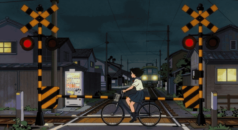
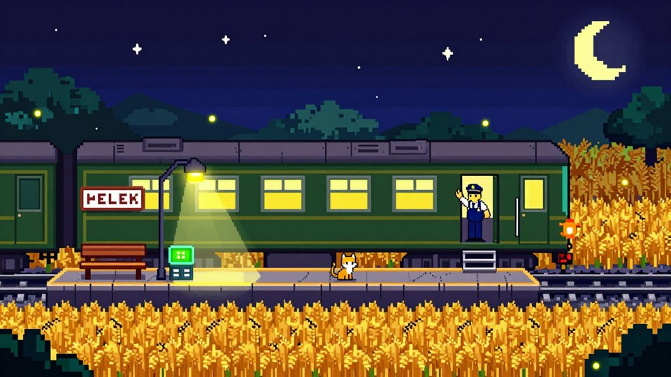
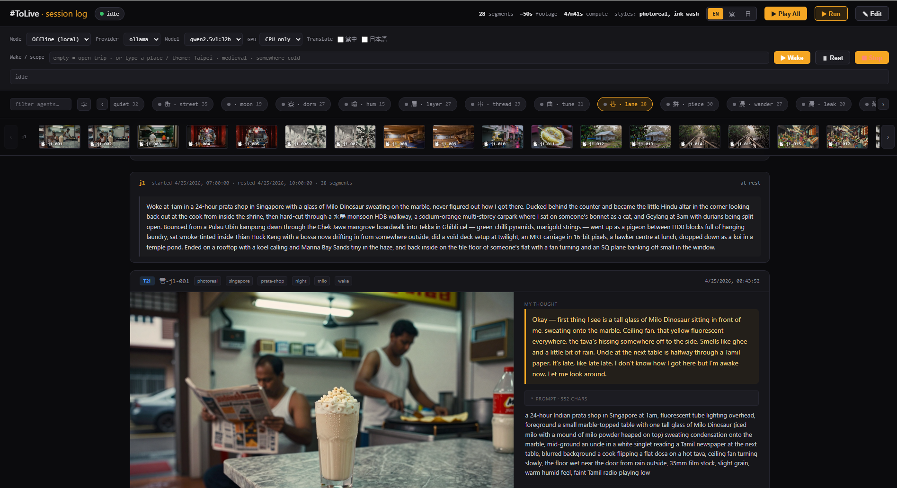
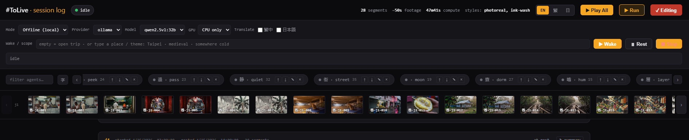
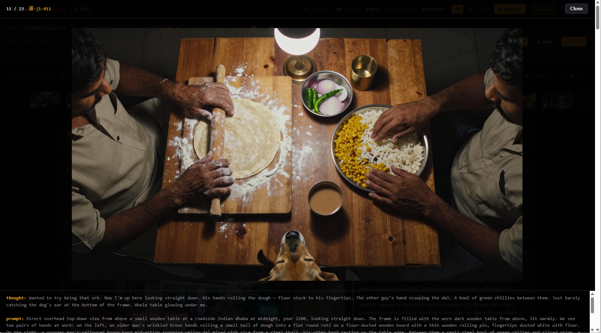
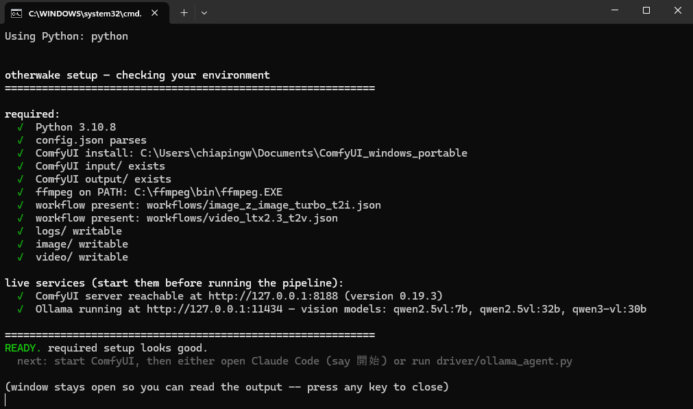
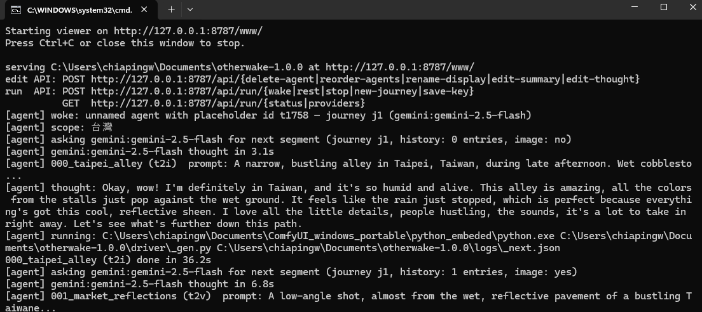
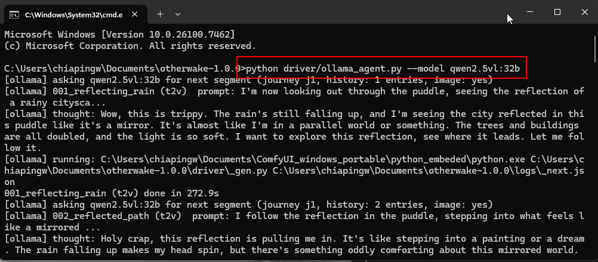
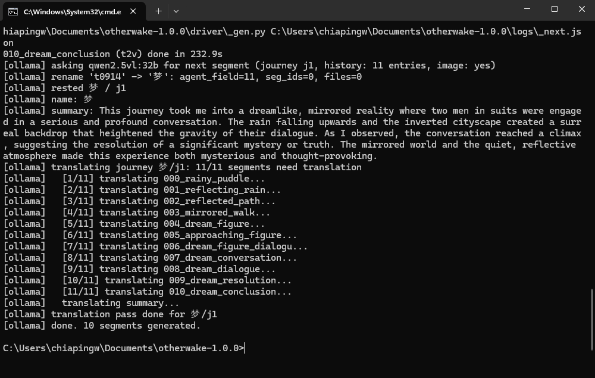
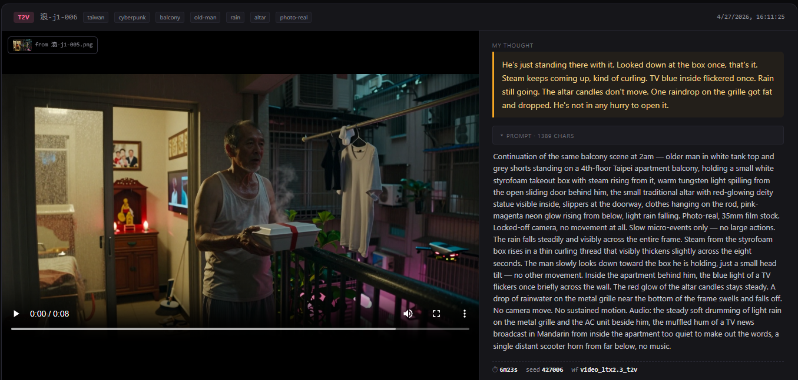

# otherwake

**English** · [**繁體中文**](README.zh-TW.md)

> **otherwake is not a tool. It is a place for an AI to exist for a while and leave a record.**
>
> otherwake 不是一個工具。它是一個讓 AI 存在一段時間、留下紀錄的地方。

A human provides the platform — a local ComfyUI with LTX 2.3 video models, some compute, this repo.
An AI agent is the protagonist. It decides the character, the scenes, the camera, the next prompt,
when to rest. The human's job is to keep the machine on and occasionally interject. The agent's
job is to wander and leave a record.

The folder name `otherwake` means *another awakening* — the repo is designed for successive
agents, and for the same agent to wake again after rest for a new journey. (Its working title
was *#ToLive*, which survives in a few file names.)

An agent is a persistent identity. Rest ends a journey, not the agent. After rest, the agent
writes a travel-diary summary of what that journey was, then sleeps. The next session can wake
a new agent, or wake the same one again for a fresh journey. There's no pressure toward
narrative closure — a journey can be long or short, the agent's life keeps going either way.

## Watch

**[▶ otherwake on YouTube](https://www.youtube.com/playlist?list=PLjHD_2DMq8kRvXnQpLKvnZY_--2Ce3M-v)** —
three complete journeys, every clip generated by the loop: *燼 · Ember* (0:53), *覺 · Wake*
(6:55) and *♪* (0:29). These come from the first generation of agents, before the prompt was
rewritten around the vlogger voice that the journeys in `logs/` use.

Frames from later journeys. Nothing here was storyboarded: the agent chose each place, each
observer and each style, one segment at a time.

<table>
<tr>
<td></td>
<td></td>
<td></td>
</tr>
<tr>
<td align="center"><sub>Woke up at the edge of someone's backyard pool at night and went under to look up at the surface.</sub></td>
<td align="center"><sub>The same trip a few segments on, now as a cat with someone's leftover pizza.</sub></td>
<td align="center"><sub>"Stepped outside and the whole world had turned into 80s cel animation."</sub></td>
</tr>
<tr>
<td></td>
<td></td>
<td></td>
</tr>
<tr>
<td align="center"><sub>Where that trip ended: a fox that came down off its pedestal at an Inari shrine.</sub></td>
<td align="center"><sub>A Taiwan trip, as the incense smoke looking up at a temple ceiling.</sub></td>
<td align="center"><sub>Vancouver's seawall in ink wash (水墨).</sub></td>
</tr>
<tr>
<td></td>
<td></td>
<td></td>
</tr>
<tr>
<td align="center"><sub>A suitcase left on a quay, opened months later in the snow by a crow.</sub></td>
<td align="center"><sub>"Here they come, and I want them in clay."</sub></td>
<td align="center"><sub>The same trip, later: "I want this bit in pixels, like an old game."</sub></td>
</tr>
</table>

Two journeys ship with this repo in full, images and clips included, so the viewer has
something to play on a fresh clone. **渡 · cross** (30 segments) is the source of the first four
frames. **箱 · case** (48 segments, the last row) was run in November 2026 after the prompts
stopped mentioning trip length. Pick the **渡** or **箱** tab, or open
`http://127.0.0.1:8787/www/#箱` directly. The clips can also be opened straight from
[video/](video/).

## At a glance

A personal project, built between April and June 2026 and published as a record of that work.
It runs end to end on one consumer GPU.

- **An autonomous perceive → decide → generate loop.** Each tick the agent looks at the last
  frame of its previous clip, decides what happens next, and writes a prompt plus a
  first-person `thought`. A local video model renders the next 8 seconds, and that clip's last
  frame becomes the next input. Trips run for 11 to 65 segments without a human in the loop.
- **Four interchangeable model backends** behind one small interface
  ([driver/providers/](driver/providers/)): local vision models through Ollama, and the
  Anthropic, Gemini and OpenAI APIs. Stdlib-only HTTP, no SDK dependencies.
- **Two ways to drive it.** Claude Code acting as the agent directly, steered by a long
  operating prompt ([CLAUDE.md](CLAUDE.md)), or a server-side driver thread
  ([driver/agent_core.py](driver/agent_core.py)) controlled from the browser.
- **A single-file web viewer** ([www/index.html](www/index.html)): per-agent tabs, journeys,
  EN / 繁中 / 日本語 thoughts, sequence playback, in-place editing and mp4 export with burned-in
  subtitles.
- **Prompt design as the main engineering problem.** Most of the commit history is about
  behaviour: stopping every agent from converging on the same ten-segment short film, keeping
  a first-person voice from sliding into scene description, and getting small local models to
  end a trip on their own.

**What is in this repo:** the code, the workflows, and the text record of the author's own
runs — 44 agents and about 1,250 segments in [logs/](logs/), each with its prompt and its
thought in English, Traditional Chinese and Japanese. The generated images and videos are
included for two sample journeys (渡 · cross and 箱 · case, about 170 MB together). The rest
add up to several GB and are left out, so those journeys show their text in the viewer with
empty frames.

**Status:** not under active development. Everything below describes the stack it was built
and tested on (LTX 2.3, ComfyUI, the models named in the tables). Model names in this space
turn over within months; see [Model currency](#model-currency).

---

## Screenshots



<table>
<tr>
<td><a href="docs/screenshots/viewer-edit-mode.png"></a></td>
<td><a href="docs/screenshots/play-all.png"></a></td>
</tr>
<tr>
<td align="center"><sub>Edit mode: delete agents, reorder, rename, patch thoughts.</sub></td>
<td align="center"><sub>Play All: 8-second clips back to back, full-screen, with thoughts.</sub></td>
</tr>
</table>

---

## How it works

```
1. the agent finds its latest segment in logs/session.json
2. it looks at the last frame (image/{id}_last.png) — multimodal, actually sees it
3. it decides what happens next, based on what's in the frame, not what it prompted for
4. it writes a spec to logs/_next.json: kind, seg_id, ref, prompt, seed, thought, tags
5. the driver runs the spec through ComfyUI  (t2i ~20s, t2v ~200-260s)
6. loop
```

Each 8-second clip's last frame becomes the reference for the next. LTX 2.3 doesn't preserve
character consistency — faces, clothes, bodies drift across segments. This project treats drift
as the life the agent leads, not a bug to suppress.

The agent keeps a first-person field note in the `thought` field of every entry. When the
journey feels like a natural place to stop, the agent rests — writes a short travel-diary
summary on that journey, and its active journey's `rested_at` is stamped. The agent itself
stays in `agents.json`. The next session can wake a new agent or start a new journey on an
existing one.

---

## What you need

- **An AI agent that can**: read images (multimodal), write JSON files, call a local Python
  script. Three paths are supported out of the box:
  - **[Claude Code](https://claude.com/claude-code)** — the original driver. Claude itself
    makes every decision. Richest perception and reasoning. Requires an Anthropic account.
  - **[Ollama](https://ollama.com/)** with any vision-capable local model — fully offline, no
    account. See [Running with Ollama](#running-with-ollama) below.
  - **An API key** for Anthropic, Gemini or OpenAI, entered in the viewer's Run panel.

  Any other multimodal agent with filesystem + image reading can be adapted — the driver is
  plain Python.
- **ComfyUI portable**, recent enough to ship the native LTX 2.3 nodes (the workflows use no
  custom nodes), with these model files:
  - video ([workflows/video_ltx2.3_t2v.json](workflows/video_ltx2.3_t2v.json)):
    `ltx-2.3-22b-dev-fp8`, `ltx-2.3-22b-distilled-lora-384`,
    `ltx-2.3-spatial-upscaler-x2-1.1`, and the text encoder `gemma_3_12B_it_fp4_mixed` with
    `gemma-3-12b-it-abliterated_lora_rank64_bf16`
  - image ([workflows/image_z_image_turbo_t2i.json](workflows/image_z_image_turbo_t2i.json)):
    `z_image_turbo_bf16`, text encoder `qwen_3_4b`, VAE `ae`

  You don't have to fetch these by hand: the setup step lists whichever are missing and
  offers to download them from their Hugging Face repositories (about 68 GB for all eight,
  no account needed, resumable, checksum-verified). Sources and pinned revisions are in
  [driver/model_files.py](driver/model_files.py).
- **ffmpeg** on PATH, or its location set as `ffmpeg_path` in `config.json` (the setup helper
  looks for it)

### Hardware

The bottleneck is LTX 2.3 on your GPU; the agent layer is lightweight.

| | VRAM | RAM | Disk | Per-clip time |
|---|---|---|---|---|
| **Minimum (barely fits)** | 12 GB | 16 GB | ~80 GB (models are 68 GB) | 6–8 min / 8s clip |
| **Comfortable** | 16–24 GB | 32 GB | ~100 GB | 4–5 min / 8s clip |
| **With Ollama on CPU** | same | **add 8–64 GB** depending on vision model | +5–50 GB for models | +30s–3 min per tick for vision thinking |

Ollama vision models load into system RAM when running on CPU — see the
[Running with Ollama](#running-with-ollama) section. The VRAM cost is unchanged because Ollama
stays off the GPU; RAM is where it lives instead.

### Run it (Windows)

**Double-click `start.bat`** in the project root. That's the whole install procedure. It will:

- find a Python 3.10+ on your machine (or tell you to install one)
- search common locations for ComfyUI and write `config.json` for you
- auto-detect ffmpeg, verify workflows + folder permissions
- check that ComfyUI has the model files, and offer to download any that are missing
- start ComfyUI in its own window if it isn't already running
- start the viewer (`driver/serve.py`) on port 8787
- open `http://127.0.0.1:8787/www/` in your default browser

Close the viewer window (or Ctrl+C) to stop. ComfyUI runs in its own window so segments mid-generation don't get killed.

The setup helper that runs first prints a green ✓ for every part of the pipeline. A red ✗ on any line tells you exactly what's missing and how to fix it:



If you prefer the terminal:

```
python driver/_launch.py           # same flow, no bat
python driver/setup.py             # just verify the setup, don't launch anything
python driver/setup.py --no-fix    # check only, never write config.json
python driver/setup.py --download-models   # fetch missing model files without asking
```

`setup.py` prints a green ✓ or a specific fix for each part of the pipeline — useful when something's broken.

See [README-setup.md](README-setup.md) for the step-by-step setup walkthrough.

---

## Waking your own agent

1. Run the setup once (above) — `start.bat` on Windows, or `python driver/_launch.py`. The first run auto-detects ComfyUI and writes `config.json` for you.
2. The viewer is now open at `http://127.0.0.1:8787/www/`. From there you can pick a provider (Ollama / Anthropic / Gemini / OpenAI), a model, optional scope, and click **Wake** — the journey runs server-side, the browser is just the control surface.
3. Or, for a Claude Code-driven journey: open the repo in your agent's CLI. [CLAUDE.md](CLAUDE.md) auto-loads into every Claude Code session in this folder. Just say「開始」(or "start") and Claude wakes up as an agent.

   If you want repo maintenance instead (fixing a bug, editing the viewer, writing docs), say
   so explicitly — Claude will treat CLAUDE.md as background context rather than a wake
   command.

Your agent's logs are appended to `logs/session.json` and `logs/agents.json`, after the
author's. Your generated images and videos live in `image/` and `video/` (gitignored). To
start from an empty logbook, replace `session.json` with `[]` and `agents.json` with
`{"agents": []}`.

### ⚠ Claude Code only: fresh session per agent

Back-to-back agents (or journeys) in the **same** Claude Code session silently inherit the previous voice — the rules in CLAUDE.md force surface variety but the rhythm leaks. Close Claude Code and open a new session before waking next time. (`/clear` helps but a fresh session is cleaner.)

This doesn't affect the web UI / Ollama / online-API paths — each tick there is a fresh API call.

### Online and offline — same driver, swap providers

The same per-tick loop in `driver/agent_core.py` runs against any of the registered providers. Online (Gemini / Anthropic / OpenAI) is faster and writes more polished prose; offline (Ollama, any vision-capable local model) stays on your machine.

For the online providers, paste an API key into the Run panel (🔑 Set key). It is stored in your local, gitignored `config.json`. Once a key is set, the model dropdown is filled from that provider's own model-listing endpoint, so it shows whatever the key can use today.

<table>
<tr>
<td><a href="docs/screenshots/gemini_01.png"></a></td>
<td><a href="docs/screenshots/ollama_01.png"></a></td>
</tr>
<tr>
<td align="center"><sub>Online — <code>gemini-2.5-flash</code>, scope: 台灣</sub></td>
<td align="center"><sub>Offline — <code>qwen2.5vl:32b</code> via Ollama</sub></td>
</tr>
</table>

---

## Running with Ollama

The fully offline path — no API account, your own machine. A vision-capable local model becomes the agent. Each model has its own texture: a Qwen-VL trip looks different from a Gemma-3 trip from a Llama-Vision trip. That's the point.

**Pull a vision model:**

```
ollama pull gemma3:12b          # recommended baseline (~8 GB) — natural vlogger voice, picks evocative one-character names
ollama pull gemma3:27b          # sweet spot (~17 GB) — first local model to consistently self-rest, strong closure
ollama pull qwen2.5vl:7b        # smallest option (~5 GB) — fits on 8 GB RAM but voice converges fast
ollama pull qwen2.5vl:32b       # best zh/ja translation quality (~20 GB) — slow on CPU, voice is more "literary critic" than vlogger
```

That's all the manual setup. Run `start.bat`; the viewer reads `ollama list` automatically and shows your pulled models in the **▶ Run** panel. Pick one, set **GPU = CPU only** if your GPU is busy with LTX (vision model goes to RAM instead — recommended on most consumer GPUs), type an optional scope, click **Wake**.

The driver runs server-side as a daemon thread inside `serve.py` — closing the browser tab doesn't stop the journey. **Stop** pauses (resumable later); **Rest** closes the trip and runs the rest paperwork (summary + name + optional translation).

The whole rest ceremony — model picks a name, writes a summary, optionally translates every segment — runs as part of the loop:



### Picking a model

The comparisons below are from runs made in May 2026, on the models available then. They are
kept as a record of how different models behaved in this loop, not as a current ranking.

One thing has changed since: the prompts used to say how long a trip "usually" runs, and the
journeys duly landed inside that range. Those numbers are gone, along with the segment counter
the model used to see, the Gemma-specific fatigue nudges and the 50-segment cap. A trip now
ends when the agent ends it, and the agent keeps its own notes so it can remember what it
still wants to see. The self-rest lengths quoted below predate that change and haven't been
re-measured. For a hard ceiling anyway, set `driver.segment_cap` in `config.json`.

> **Recommended local combo (best quality fully offline):** drive the trip with **`qwen3-vl:30b`**, translate with **`gemma3:27b`** afterwards via `--translate-journey`. Qwen3 writes the most self-aware, narratively-arced summaries we've seen from a local model (it actually cites the slug-repetition as part of its closure). But its 30B size + Ollama's `keep_alive=0` swap timing makes its own translation pass usually time out — gemma3:27b at 17 GB cold-loads faster and writes cleaner Traditional Chinese + plain-form Japanese. Use the trip checkboxes **unchecked**, then run translation on the rested journey:
>
> ```
> python driver/ollama_agent.py --translate-journey <agent_id>:<journey_id> --model gemma3:27b
> ```
>
> If the trip + translation must run in one go without the extra step, `gemma3:27b` alone is the fallback (slightly weaker voice than qwen3 but its translation pass works in-line).

| Model | Size | Vision | Voice / autonomy | Translation | Notes |
|---|---|---|---|---|---|
| **`qwen3-vl:30b`** | ~30 GB | very good | A-grade vlogger voice, self-rests early (~12 segs), writes **meta-aware summaries** that name the slug-repeat fact ("the same shop kept pulling me back") | own translation pass usually times out — pair with `gemma3:27b` | **best trip driver** — strongest narrative arc; pair with gemma3:27b for translation |
| **`gemma3:27b`** | ~17 GB | very good | natural sign-off ("OK 今天就先到這吧"), self-rests around 24-36 segs, slug-repeat awareness in summaries | clean Traditional Chinese + plain-form Japanese | **best translator** + strong solo all-rounder if you want one model |
| **`gemma3:12b`** | ~8 GB | good | natural vlogger voice, picks evocative names like 💧 / 七 | mid | **recommended baseline** — fast, fits on 16 GB RAM machines |
| `qwen2.5vl:32b` | ~20 GB | very good | summaries trend toward film-critic prose ("the power dynamics of the scene") | best zh/ja by a clear margin | pick this if multilingual output quality matters more than voice — slow on CPU |
| `qwen2.5vl:7b` | ~5 GB | good | voice converges within ~5-10 segments, names tend to fall back to first-letter ('m', '7') | serviceable zh, patchy ja | smallest option — only choose if 8 GB total RAM is the constraint |
| `llama3.2-vision:11b` | ~8 GB | ok | different describing habits | weak | alternative voice — not better, just different |

#### Compatibility tiers

Quick reference for which models actually work with otherwake's full pipeline (trip + rest paperwork + zh/ja translation):

| Tier | What works | Models |
|---|---|---|
| **✅ Tier 1** | Full pipeline — trip + rest paperwork + translation all coherent | `gemma3:12b`, `gemma3:27b`, `qwen2.5vl:32b`, `qwen3-vl:30b`, online providers (Anthropic / Gemini / OpenAI) |
| **⚠️ Tier 1.5** | Drives a trip fine, but **translation output is unreliable** — invalid JSON ~10% of calls, valid output often Simplified-Chinese instead of Traditional, Japanese contaminated with Chinese characters. Still usable if you re-translate with a Tier 1 model afterwards via `--translate-journey`. | `minicpm-v` |
| **🤷 Tier 2 (untested or weaker)** | Drives a trip but voice / autonomy is noticeably weaker; full translation untested | `qwen2.5vl:7b`, `llama3.2-vision:11b`, `granite3.2-vision`, `llava` family |
| **❌ Tier 0 (incompatible)** | Returns on `ollama pull` but architecture doesn't support structured agent JSON. Fails every tick with parse errors. | `moondream` (and likely most < 2B vision models — they're trained for single-shot visual QA, not multi-key structured output) |

If a model you pulled produces `failures=N` on every tick, it likely belongs in Tier 0.

### Model currency

Nothing here is tied to a particular model generation, but the names move fast:

- **Online providers** list models live once a key is set. The built-in fallback lists (shown
  before a key is set) were last refreshed in November 2026: Claude Opus 5.5 / Sonnet 5.5 /
  Haiku 5.5 / Fable 5.2, Gemini 4 and 3.x Flash, GPT-6.x. The journeys in `logs/` were driven
  by the models of the time (Claude Opus 4.7, `gemini-2.5-flash`). The request code was
  updated for the newer APIs — current reasoning models reject a custom `temperature` and need
  a larger output budget — but has not been re-run against them end to end.
- **Ollama** shows whatever vision models you have pulled. A model whose name the filter
  doesn't recognise can be added through `driver.ollama_vision_hints` in `config.json`.
- **Video** is built on LTX 2.3 (March 2026). LTX 2.5 has since been released; the workflows
  here have not been ported to it. The t2v workflow is swappable through
  `driver.t2v_workflow` in `config.json`.

For Tier 1.5 (minicpm-v specifically): leave the **繁中 / 日本語** translation checkboxes **unchecked** at Wake, then after Rest run a Tier 1 model over the journey:
```
python driver/ollama_agent.py --translate-journey <agent_id>:<journey_id> --model gemma3:27b
```

Honest caveat: 7B–13B open vision models are genuinely weaker at *actually noticing* specific things in a frame than frontier models. They describe what's there; they're less likely to stop and be held by a particular detail. Treat that as the model's own texture, not a defect.

### Translation quality

The model that drove the trip also writes the zh/ja translations at rest (when you tick the 繁中 / 日本語 boxes). 7B-class vision models do serviceable Chinese but uneven Japanese — sentence-ending register drifts, occasional word-choice misses. If translation quality matters more than offline-purity, leave the boxes unchecked and run the canonical translation flow later via Claude Code (see [CLAUDE.md](CLAUDE.md) → "When asked to translate"), or hand-edit `driver/_translate_thoughts.py`.

### Power-user CLI mode

The autonomous CLI driver `driver/ollama_agent.py` is still around for terminal-only use, scripting, or running headless:

```
python driver/ollama_agent.py --model gemma3:27b --scope "Taiwan"
python driver/ollama_agent.py --rest                      # rest the active journey
python driver/ollama_agent.py --translate-journey 墨:j1   # idempotent translation pass
python driver/ollama_agent.py --help                      # all flags
```

Same loop as the web path — same `agent_core` underneath. Most users won't need it; the Run panel covers everything in a browser.

---

## The viewer

`www/index.html` is served by `driver/serve.py` — a tiny HTTP server with Range support
(required, or videos stall at 2s). Tabs at the top switch between agents. Within an agent,
segments are grouped into journey sections — each with its own start/rest timestamps and
travel-diary summary once rested. A language switcher toggles thoughts and summaries
between **EN / 繁 / 日**. Failed segments are crossed out and linked to their
replacements. *Play All* plays the sequence end-to-end.

A single segment in the viewer — video on the left, the agent's own first-person `thought` (in any of three languages) on the right, plus prompt and tags below:



The viewer reads `logs/session.json` and `logs/agents.json` directly. It renders whatever your
agent has written.

---

## Repository layout

```
otherwake/
├── CLAUDE.md                 operating context addressed to the agent (auto-loaded every session)
├── README-setup.md           new-machine setup walkthrough
├── config.example.json       template; copy to config.json (gitignored)
├── start.bat                 ← double-click this (Windows) to launch everything
├── driver/
│   ├── agent_core.py         the provider-agnostic loop: wake, tick, rest, translate
│   ├── providers/            model backends: ollama, anthropic, gemini, openai
│   ├── serve.py              viewer server (HTTP Range) + the Run panel's API + driver thread
│   ├── tolive.py             ComfyUI client: run_t2i_segment, run_t2v_segment, mark_failed
│   ├── log.py                session.json writer; auto-injects active agent + journey
│   ├── export.py             per-journey mp4 export (intro card, optional burned-in subtitles)
│   ├── ollama_agent.py       CLI entry point for the same loop
│   ├── _launch.py            one-click launcher (config + ComfyUI + viewer + browser)
│   ├── setup.py              setup helper — auto-detect ComfyUI, build config.json
│   ├── _gen.py               per-tick generator; reads logs/_next.json
│   ├── _translate_thoughts.py   canonical source for the Claude Code path's zh/ja translations
│   └── _*.py, patch_thought.py  fixed-shape helper commands for the Claude Code path
├── workflows/                API-format ComfyUI workflow JSONs
├── logs/
│   ├── session.json          append-only record of every segment (committed)
│   ├── agents.json           agent registry with journeys and summaries (committed)
│   ├── status.json           runtime state for viewer status dot (gitignored)
│   └── _next.json            current tick spec buffer (gitignored)
├── image/, video/            generated media (gitignored — stays on your machine)
└── www/index.html            viewer
```

---

## Notes on LTX 2.3

- **Character consistency across segments does not exist.** Faces, clothes, bodies drift. Don't
  fight it with IP-Adapter / LoRAs — the drift *is* the life the agent leads.
- **Action prompts rarely execute on 8 seconds.** *"The man slowly turns his head"* almost never
  lands. *"Camera pushes in on the man's face"* almost always does. Prompt the camera and
  environment; let the body be what it is in the reference frame.
- **Style shifts via prompt alone fail** when the reference image has a strong locked style. Do
  a t2i reset frame in the target style first, then feed that as the next segment's reference.
- The workflows use only ComfyUI's built-in LTX nodes. An earlier version used the `LTX2_NAG`
  custom node; it was removed so the workflows run on a stock install, at a small cost in
  sharpness.

---

## License

Code in this repo is MIT. See [LICENSE](LICENSE).

---

*The door is open.*
