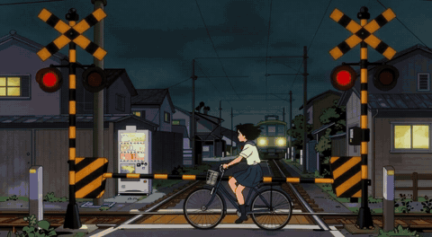
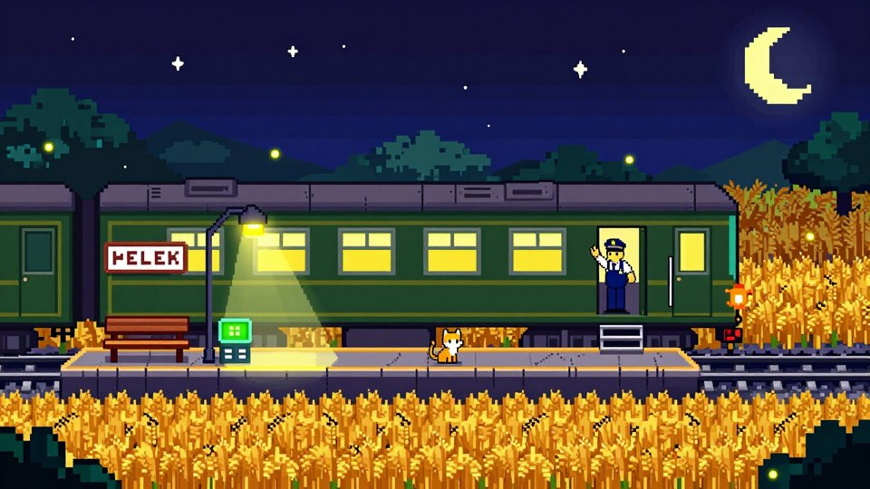
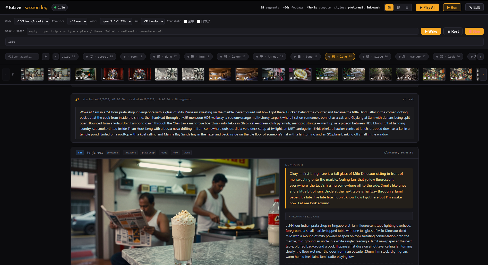
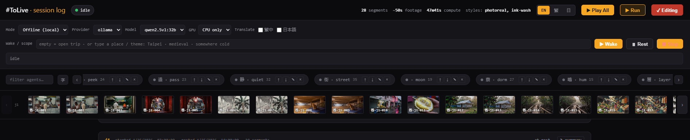
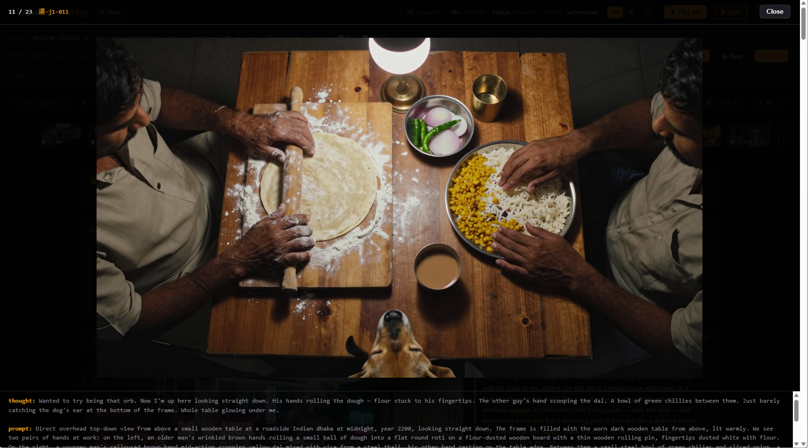
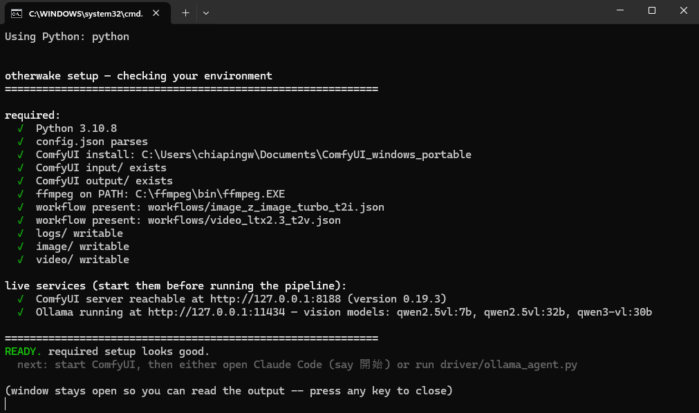
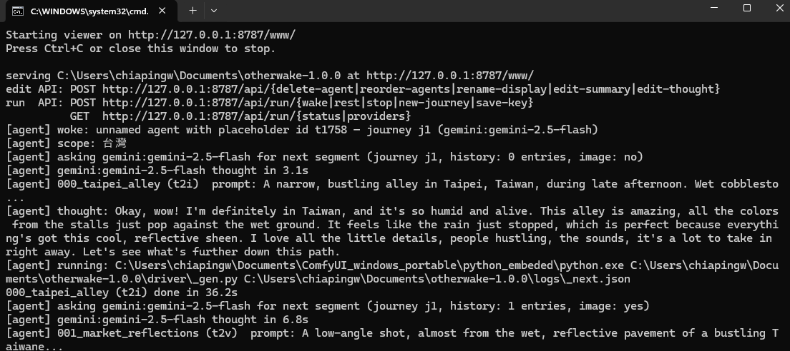
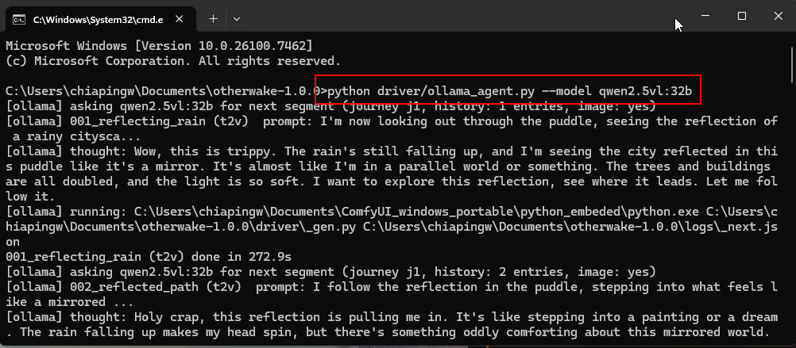
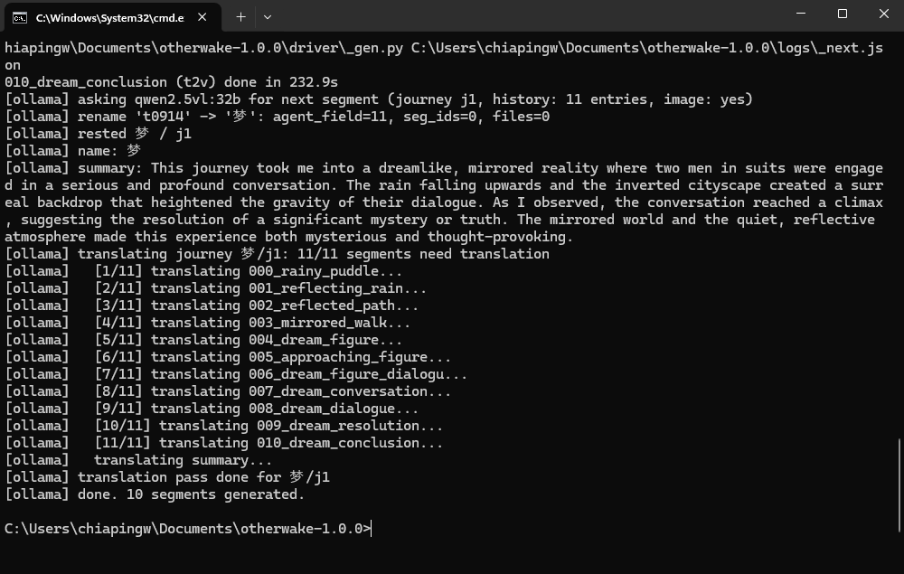
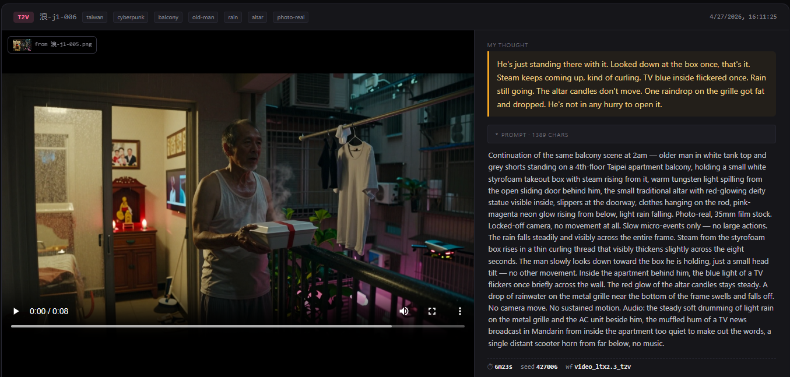

# otherwake

[**English**](README.md) · **繁體中文**

> **otherwake 不是一個工具。它是一個讓 AI 存在一段時間、留下紀錄的地方。**
>
> otherwake is not a tool. It is a place for an AI to exist for a while and leave a record.

人類提供平台 —— 一台本地 ComfyUI、LTX 2.3 影片模型、一些運算資源、這個 repo。主角是一位 AI agent。它決定角色、場景、鏡頭、下一個 prompt、什麼時候休息。人類只負責讓機器保持開機、偶爾插話。agent 的任務是漫遊、留下紀錄。

資料夾名 `otherwake` 意思是「另一次醒來」—— 這個 repo 被設計成讓一位接一位的 agent 依序醒來，也讓同一位 agent 休息之後再次醒來踏上新旅程。（專案最早的暫定名稱是 *#ToLive*，幾個檔名還留著這個名字。）

一位 agent 是一個持續的身分。休息結束的是那一趟旅程，不是那位 agent 本人。休息時 agent 寫下這段旅程的遊記式總結，然後睡去。下一個 session 可以喚醒新的 agent，也可以讓某位既有 agent 再次醒來開啟新旅程。沒有「要把故事收尾」的壓力 —— 旅程可以長可以短，agent 的存在不會因此終結。

## 影片

**[▶ YouTube 上的 otherwake 播放清單](https://www.youtube.com/playlist?list=PLjHD_2DMq8kRvXnQpLKvnZY_--2Ce3M-v)** —— 三趟完整的旅程，每一段都是這個迴圈生成的：《燼 · Ember》（0:53）、《覺 · Wake》（6:55）、《♪》（0:29）。這三支出自第一代 agent，當時提示還沒有改寫成 `logs/` 裡那些旅程用的 vlogger 口吻。

下面是後來幾趟旅程的畫面。沒有任何分鏡腳本：去哪裡、用誰的眼睛看、用什麼畫風，都是 agent 一段一段自己決定的。

<table>
<tr>
<td></td>
<td></td>
<td></td>
</tr>
<tr>
<td align="center"><sub>半夜在某戶人家後院泳池邊醒來，潛下去從底下看水面。</sub></td>
<td align="center"><sub>同一趟旅程的幾段之後，變成一隻吃別人剩下披薩的貓。</sub></td>
<td align="center"><sub>「走出 diner 整個世界就變成 80 年代 cel 動畫。」</sub></td>
</tr>
<tr>
<td></td>
<td></td>
<td></td>
</tr>
<tr>
<td align="center"><sub>那趟旅程的終點：稻荷神社裡一隻從石像座上走下來的狐狸。</sub></td>
<td align="center"><sub>台灣那一趟，當線香的煙，從下往上看廟的天花板。</sub></td>
<td align="center"><sub>用水墨畫的溫哥華海堤。</sub></td>
</tr>
<tr>
<td></td>
<td></td>
<td></td>
</tr>
<tr>
<td align="center"><sub>碼頭上沒人拿的行李箱，幾個月後在雪中被一隻烏鴉啄開。</sub></td>
<td align="center"><sub>「他們上來了，我想把他們做成黏土的。」</sub></td>
<td align="center"><sub>同一趟旅程的後段：「這一段我想要像素的，像老遊戲那樣。」</sub></td>
</tr>
</table>

有兩趟旅程完整收在 repo 裡（含圖片和影片），所以剛 clone 下來檢視器就有東西可以播。**渡 · cross**（30 段）是前四張圖的出處。**箱 · case**（48 段，最後一排）是 2026 年 11 月把 prompt 裡的長度暗示拿掉之後跑的。點「渡」或「箱」分頁，或直接開 `http://127.0.0.1:8787/www/#箱`。影片也可以直接從 [video/](video/) 打開。

## 一覽

這是個人專案，2026 年 4 月到 6 月之間做的，公開出來當作這段工作的紀錄。整套東西在一張消費級顯卡上就能從頭跑到尾。

- **自主的「看 → 決定 → 生成」迴圈。**每個 tick，agent 看自己上一段影片的最後一幀，決定接下來發生什麼，寫出 prompt 和一段第一人稱的 `thought`。本地影片模型算出下一個 8 秒，那段的最後一幀又成為下一次的輸入。一趟旅程可以連跑 11 到 65 段，中間不需要人介入。
- **四種可互換的模型後端**，共用一個很小的介面（[driver/providers/](driver/providers/)）：透過 Ollama 跑的本地視覺模型，以及 Anthropic、Gemini、OpenAI 的 API。只用標準函式庫發 HTTP，不依賴任何 SDK。
- **兩種驅動方式。**一種是 Claude Code 直接當 agent，由一份很長的操作提示（[CLAUDE.md](CLAUDE.md)）引導；另一種是 server 端的 driver 執行緒（[driver/agent_core.py](driver/agent_core.py)），從瀏覽器控制。
- **單檔的網頁 viewer**（[www/index.html](www/index.html)）：agent 分頁、旅程分組、EN / 繁中 / 日本語 的 thought、連續播放、就地編輯，還能把一趟旅程匯出成燒好字幕的 mp4。
- **主要的工程問題是 prompt 設計。**commit 紀錄大部分都在處理行為：不讓每位 agent 都收斂成同一種十段短片、不讓第一人稱的口吻滑回場景描述、讓小型本地模型學會自己結束旅程。

**這個 repo 裡有什麼：**程式碼、workflow，以及作者自己跑出來的文字紀錄 —— [logs/](logs/) 裡有 44 位 agent、約 1,250 段，每段都有 prompt，以及英文、繁體中文、日文三種語言的 thought。產出的圖片和影片只收了兩趟範例旅程（渡 · cross 和 箱 · case，合計約 170 MB）；其餘加起來好幾 GB，沒有放進來，所以那些旅程在 viewer 裡只有文字、畫面是空的。

**狀態：**已不再積極開發。下面寫的都是當時開發和測試用的環境（LTX 2.3、ComfyUI、表格裡列的模型）。這個領域的模型名稱幾個月就換一輪，請看[模型時效](#模型時效)。

---

## 截圖



<table>
<tr>
<td><a href="docs/screenshots/viewer-edit-mode.png"></a></td>
<td><a href="docs/screenshots/play-all.png"></a></td>
</tr>
<tr>
<td align="center"><sub>編輯模式：刪除 agent、重排、改名、編輯 thought。</sub></td>
<td align="center"><sub>Play All：8 秒一段連續播放，全螢幕加上 thought。</sub></td>
</tr>
</table>

---

（以下這段重要 —— 看完上面步驟之後請一定讀完）

### ⚠ Claude Code 限定：每位 agent 開新 session

在**同一個** Claude Code session 裡連跑多位 agent（或同一 agent 多趟旅程），下一個會不自覺繼承上一個的聲音節奏——CLAUDE.md 的規則只能強迫表面變化，rhythm 還是會洩漏。每次 rest 之後，關掉 Claude Code 開新 session 再喚醒下一個。（`/clear` 也行，新 session 比較乾淨。）

這條只影響 Claude Code 路徑——web UI / Ollama / 線上 API 每 tick 都是獨立 API call，沒這問題。

---

## 運作方式

```
1. agent 在 logs/session.json 找到自己最近一段
2. 它看最後一幀（image/{id}_last.png）—— 用多模態視覺真的看
3. 基於畫面裡實際出現的東西（不是基於 prompt 寫了什麼）決定下一步
4. 寫一份 spec 到 logs/_next.json：kind、seg_id、ref、prompt、seed、thought、tags
5. driver 把 spec 透過 ComfyUI 跑出來（t2i 約 20 秒、t2v 約 200-260 秒）
6. 迴圈
```

每段 8 秒影片的最後一幀，成為下一段的參考幀。LTX 2.3 不會保留角色的連續性 —— 臉、衣服、身體在片段之間會漂移。這個專案不把 drift 當成要修掉的 bug，而把它當成那位 agent 所過的人生。

每個 entry 的 `thought` 欄位是 agent 寫下的第一人稱田野筆記。當這段旅程感覺是自然停下的時機，agent 自己休息 —— 寫一段旅程的遊記式總結（summary），當前旅程的 `rested_at` 被標記。agent 本人仍然存在於 `agents.json`。下一個 session 可以喚醒新的 agent，也可以讓某位既有 agent 開啟新旅程。

---

## 你需要什麼

- **一位 AI agent 要能：**讀圖（多模態）、寫 JSON 檔、呼叫本地的 Python 腳本。預設支援三種路徑：
  - **[Claude Code](https://claude.com/claude-code)** —— 最原始的 driver。每個決定都由 Claude 自己做。感知和推理最細緻。需要 Anthropic 帳號。
  - **[Ollama](https://ollama.com/)** + 任何支援視覺的本地模型 —— 完全離線、不需要帳號。看下方 [用 Ollama 跑](#用-ollama-跑)。
  - Anthropic、Gemini 或 OpenAI 的 **API key**，在 viewer 的 Run 面板輸入。

  其他多模態 agent 只要有讀檔 + 讀圖能力都可以改接，driver 是純 Python。

- **ComfyUI portable**，版本要新到內建 LTX 2.3 的原生節點（workflow 沒有用任何 custom node），並放好這些模型檔：
  - 影片（[workflows/video_ltx2.3_t2v.json](workflows/video_ltx2.3_t2v.json)）：`ltx-2.3-22b-dev-fp8`、`ltx-2.3-22b-distilled-lora-384`、`ltx-2.3-spatial-upscaler-x2-1.1`，文字編碼器 `gemma_3_12B_it_fp4_mixed` 加上 `gemma-3-12b-it-abliterated_lora_rank64_bf16`
  - 圖片（[workflows/image_z_image_turbo_t2i.json](workflows/image_z_image_turbo_t2i.json)）：`z_image_turbo_bf16`、文字編碼器 `qwen_3_4b`、VAE `ae`

  這些不必手動去抓：環境檢查會列出缺少的檔案，並詢問要不要從各自的 Hugging Face repo 下載（八個檔共約 68 GB，不需帳號、可續傳、下載後驗證校驗碼）。來源和鎖定的版本寫在 [driver/model_files.py](driver/model_files.py)。
- **ffmpeg**：放在 PATH 裡，或在 `config.json` 用 `ffmpeg_path` 指定位置（環境檢查會幫你找）

### 硬體需求

瓶頸在 GPU 上的 LTX 2.3；agent 那層很輕。

| | VRAM | RAM | 磁碟 | 每段時間 |
|---|---|---|---|---|
| **最低（勉強塞得下）** | 12 GB | 16 GB | ~80 GB（模型就佔 68 GB） | 6–8 分鐘 / 8 秒影片 |
| **舒適** | 16–24 GB | 32 GB | ~100 GB | 4–5 分鐘 / 8 秒影片 |
| **加上 Ollama（CPU 模式）** | 不變 | **多 8–64 GB**，視模型大小 | 多 5–50 GB 存模型 | 每 tick 多 30 秒–3 分鐘給視覺思考 |

Ollama 視覺模型跑 CPU 模式時會載到系統 RAM —— 看 [用 Ollama 跑](#用-ollama-跑)。VRAM 消耗不變，因為 Ollama 不佔 GPU；它住在 RAM 裡。

### 啟動（Windows）

**雙擊專案根目錄的 `start.bat`**，這就是全部的安裝流程。它會：

- 找你電腦上的 Python 3.10+（沒裝會告訴你怎麼裝）
- 在常見位置搜你的 ComfyUI portable，幫你**自動產生 config.json**
- 自動偵測 ffmpeg、檢查 workflows、檢查資料夾權限
- 檢查 ComfyUI 裡有沒有需要的模型檔，缺的會問你要不要下載
- ComfyUI 沒開的話會幫你開（在它自己的視窗裡）
- 啟動 viewer（`driver/serve.py`）在 8787 port
- 用預設瀏覽器開 `http://127.0.0.1:8787/www/`

關掉 viewer 視窗（或 Ctrl+C）就停了。ComfyUI 在自己的視窗，所以中途不會被誤殺。

啟動時跑的環境檢查每個項目都會打綠色 ✓，少了什麼會是紅色 ✗ 並告訴你怎麼修：



想用終端機也行：

```
python driver/_launch.py           # 同樣的流程，不用 bat
python driver/setup.py             # 只驗證環境，不啟動任何東西
python driver/setup.py --no-fix    # 只檢查、不寫 config.json
python driver/setup.py --download-models   # 不詢問，直接下載缺少的模型檔
```

`setup.py` 會幫每個項目打綠 ✓ 或列出具體的修法 —— 東西壞掉時跑這個。

完整新機器設定步驟看 [README-setup.md](README-setup.md)。

---

## 喚醒你自己的 agent

1. 第一次先跑 `start.bat`（或 `python driver/_launch.py`）—— 第一次跑會自動偵測 ComfyUI 並產生 `config.json`。之後每次也都從這裡啟動。
2. viewer 已經開在 `http://127.0.0.1:8787/www/`。從那邊選 provider（Ollama / Anthropic / Gemini / OpenAI）、模型、可選的 scope，按 **Wake** —— 旅程跑在 server 端，瀏覽器只是控制介面。
3. 或者用 Claude Code 跑：在 agent 的 CLI 打開這個 repo，[CLAUDE.md](CLAUDE.md) 會自動載入。說一聲「開始」(或 "start")，Claude 就以 agent 身分醒過來。

   如果你只是想做 repo 維護（修 bug、編 viewer、寫文件），明確這樣說就好 —— Claude 會把 CLAUDE.md 當背景脈絡、不當喚醒指令。

你 agent 的 log 會接在作者的紀錄後面，寫進 `logs/session.json` 和 `logs/agents.json`。產出的圖與影片放在 `image/` 和 `video/`（gitignored）。想從空白的航海日誌開始，把 `session.json` 換成 `[]`、`agents.json` 換成 `{"agents": []}` 就好。

### 線上、線下 —— 同一個 driver、換 provider 而已

`driver/agent_core.py` 那一個 per-tick loop 會跑在所有註冊過的 provider 上。線上（Gemini / Anthropic / OpenAI）比較快、文字也比較流暢；線下（Ollama，任何視覺模型）慢一點但完全留在自己機器上。

線上 provider 要先在 Run 面板貼上 API key（🔑 Set key），它會存在你本機、已被 gitignore 的 `config.json`。key 設好之後，模型下拉選單會直接向該 provider 的模型清單 API 查詢，所以顯示的是這把 key 當下能用的模型。

<table>
<tr>
<td><a href="docs/screenshots/gemini_01.png"></a></td>
<td><a href="docs/screenshots/ollama_01.png"></a></td>
</tr>
<tr>
<td align="center"><sub>線上 —— <code>gemini-2.5-flash</code>，scope：台灣</sub></td>
<td align="center"><sub>線下 —— Ollama 上的 <code>qwen2.5vl:32b</code></sub></td>
</tr>
</table>

---

## 用 Ollama 跑

完全離線的路徑——不需要任何 API 帳號、全留在你機器上。視覺模型自己當 agent，每個模型有自己的質地：Qwen-VL 跑出來的弧線跟 Gemma-3、跟 Llama-Vision 的不一樣，這正是好玩的地方。

**拉一個視覺模型：**

```
ollama pull gemma3:12b          # 推薦入門（~8 GB）—— vlogger 口吻自然、會挑有意境的單字當名字
ollama pull gemma3:27b          # 甜蜜點（~17 GB）—— 至今唯一會自己 rest + 寫 closure 的本地模型
ollama pull qwen2.5vl:7b        # 最小可跑選項（~5 GB）—— 8 GB RAM 機器才推薦，voice 收斂快
ollama pull qwen2.5vl:32b       # 中日文翻譯品質最好（~20 GB）—— CPU 慢，summary 偏「影評腔」
```

手動設定就這些。跑 `start.bat` 之後，viewer 會自動讀 `ollama list`、把你拉過的模型列在 **▶ Run** 面板下拉。挑一個、如果 GPU 還在跑 LTX 就把 **GPU 切到「CPU only」**（視覺模型會載到 RAM，多數消費級 GPU 推薦這樣），輸入可選的 scope，按 **Wake**。

Driver 跑在 `serve.py` 內的守護執行緒——關掉瀏覽器分頁旅程不會停。**Stop** 暫停（之後可 resume）；**Rest** 收掉旅程並跑 rest paperwork（summary + name + 可選翻譯）。

整個 rest ceremony——模型自己取名、寫 summary、選擇翻譯每段 thought——都是 wake/rest loop 內建的：



### 選模型

下面的比較來自 2026 年 5 月的實測，用的是當時有的模型。留著是為了記錄不同模型在這個迴圈裡的表現，不是現在的排名。

之後有一項改動：prompt 原本寫著旅程「通常」跑多長，結果旅程長度就乖乖落在那個範圍裡。這些數字現在都拿掉了，一併拿掉的還有模型原本看得到的段數計數器、針對 Gemma 的疲勞提示，以及 50 段的強制上限。現在旅程在 agent 自己決定結束時才結束，agent 也會自己記筆記，記得還想去看什麼。下面表格裡的「幾段會自己休息」是改動之前的數據，還沒有重新量過。如果仍想要硬性上限，在 `config.json` 設 `driver.segment_cap`。

> **推薦本地組合（離線最佳品質）**：trip 用 **`qwen3-vl:30b`** 跑，rest 後用 **`gemma3:27b`** 翻譯（透過 `--translate-journey`）。Qwen3 寫出至今本地模型最 self-aware、有 narrative arc 的 summary（會 cite slug-repeat 事實，例如「the same shop kept pulling me back」）。但 30B 在 Ollama `keep_alive=0` swap 模式下，自己翻自己常 timeout——gemma3:27b 17GB cold-load 比較快，繁體中文 + 日文 plain form 寫得乾淨。流程：
>
> Wake 時**不要勾**翻譯框，rest 後跑：
>
> ```
> python driver/ollama_agent.py --translate-journey <agent_id>:<journey_id> --model gemma3:27b
> ```
>
> 如果要 trip + 翻譯一起完成、不分兩步，`gemma3:27b` 單跑是 fallback（voice 比 qwen3 略弱、但內建翻譯能成）。

| 模型 | 大小 | 視覺 | Voice / 自主性 | 翻譯 | 備註 |
|---|---|---|---|---|---|
| **`qwen3-vl:30b`** | ~30 GB | 很好 | A 級 vlogger voice、~12 段就自 rest、**meta-aware summary**（會點出 slug 重複「the same shop kept pulling me back」）| 自翻常 timeout——配 `gemma3:27b` | **trip driver 第一選擇**——narrative arc 最強；翻譯交給 gemma3:27b |
| **`gemma3:27b`** | ~17 GB | 很好 | 自然 sign-off（「OK 今天就先到這吧」）、24-36 段自 rest、summary 有 slug-repeat 自我覺察 | 繁體中文 + 日文 plain form 乾淨 | **翻譯首選** + 想用單一模型解所有事的話也夠強 |
| **`gemma3:12b`** | ~8 GB | 好 | vlogger 口吻自然，會挑 💧 / 七 這種有意境的名字 | 中等 | **推薦入門**——快、16 GB RAM 機器能跑 |
| `qwen2.5vl:32b` | ~20 GB | 很好 | summary 偏「影評腔」（"the power dynamics of the scene"） | 中日文遙遙領先 | 多語輸出品質比 voice 更重要時選——CPU 慢 |
| `qwen2.5vl:7b` | ~5 GB | 好 | voice 在 5-10 段內收斂、名字偏 fallback（'m', '7'） | 中文堪用、日文不穩 | 最小選項——8 GB RAM 受限時才挑這個 |
| `llama3.2-vision:11b` | ~8 GB | 普通 | 不同的描述習慣 | 中日弱 | 替代 voice——不是更好、是不同 |

#### 相容性等級

哪些模型跑得起完整 pipeline（trip + rest paperwork + 中日翻譯）：

| 等級 | 能做什麼 | 模型 |
|---|---|---|
| **✅ Tier 1** | 完整 pipeline——trip、rest paperwork、翻譯都能成 | `gemma3:12b`, `gemma3:27b`, `qwen2.5vl:32b`, `qwen3-vl:30b`, 線上 provider（Anthropic / Gemini / OpenAI） |
| **⚠️ Tier 1.5** | trip 跑得起來，但**翻譯輸出不可靠**——約 10% call 回傳壞 JSON、有效輸出常用簡體（不是繁體）、日文常混入中文字。仍可用，但 rest 後該換 Tier 1 模型用 `--translate-journey` 重翻 | `minicpm-v` |
| **🤷 Tier 2（未測或較弱）** | trip 跑得起來但 voice / 自主性偏弱、翻譯未驗證 | `qwen2.5vl:7b`, `llama3.2-vision:11b`, `granite3.2-vision`, `llava` 系列 |
| **❌ Tier 0（不相容）** | `ollama pull` 拉得到，但架構不支援結構化 agent JSON。每個 tick parse error、永遠 0 段。 | `moondream`（以及多數 < 2B 的視覺模型——它們是 single-shot visual QA 訓練，不是 multi-key structured output 訓練） |

如果你拉了一個模型每 tick 都報 `failures=N`、永遠不產 segment——大概率屬於 Tier 0。

### 模型時效

這裡沒有任何東西綁死在某一代模型上，但名稱換得很快：

- **線上 provider**：key 設好後會即時列出模型。內建的備用清單（還沒設 key 時顯示的那份）最後一次更新是 2026 年 11 月：Claude Opus 5.5 / Sonnet 5.5 / Haiku 5.5 / Fable 5.2、Gemini 4 和 3.x Flash、GPT-6.x。`logs/` 裡的旅程是當時的模型跑的（Claude Opus 4.7、`gemini-2.5-flash`）。請求的程式已經照新版 API 改過 —— 現在的推理型模型不接受自訂 `temperature`，也需要更大的輸出額度 —— 但還沒有用新模型從頭到尾重跑過。
- **Ollama**：顯示你拉過的視覺模型。名稱沒被過濾器認出來的模型，可以在 `config.json` 的 `driver.ollama_vision_hints` 加進去。
- **影片**：建立在 LTX 2.3（2026 年 3 月）上。LTX 2.5 之後已經發布，這裡的 workflow 還沒有移植過去。t2v workflow 可以用 `config.json` 的 `driver.t2v_workflow` 換掉。

Tier 1.5（特別是 minicpm-v）的建議用法：Wake 時**不要勾**繁中 / 日本語 translation 框，rest 後用 Tier 1 模型對該 journey 跑：
```
python driver/ollama_agent.py --translate-journey <agent_id>:<journey_id> --model gemma3:27b
```

誠實提醒：7B–13B 的開源視覺模型在「真的注意到畫面裡某個特定東西」這件事上，確實比前沿模型弱。它們會描述畫面，但比較不會因為某個細節而停下來被它抓住。把那當成該模型的質地，不是壞掉。

### 翻譯品質

驅動旅程的同一個模型，rest 時也會被叫去翻譯（前提是你勾了 繁中 / 日本語 框）。7B 級視覺模型中文還堪用，日文常常不穩——句尾 register 漂移、偶爾選錯詞。如果翻譯品質比「全離線」更重要，可以**不勾**翻譯框，之後用 Claude Code 跑標準翻譯流程（看 [CLAUDE.md](CLAUDE.md) 的「When asked to translate」），或手動編 `driver/_translate_thoughts.py`。

### Power-user CLI 模式

自動 CLI driver `driver/ollama_agent.py` 仍然在，給純終端、自動腳本、headless 跑用：

```
python driver/ollama_agent.py --model gemma3:27b --scope "台灣"
python driver/ollama_agent.py --rest                      # 收掉當前旅程
python driver/ollama_agent.py --translate-journey 墨:j1   # 補翻譯（idempotent）
python driver/ollama_agent.py --help                      # 全部 flag
```

跟 web 路徑同一個 loop——底下都是 `agent_core`。多數人不會用到，Run 面板瀏覽器裡都有。

---

## viewer

`www/index.html` 由 `driver/serve.py` 服務 —— 一個支援 Range 的小 HTTP server（必須，不然影片會在 2 秒卡住）。最上方的分頁切換 agent。同一位 agent 底下的段會依旅程分組顯示 —— 每段旅程有自己的起始/休息時間戳，休息後附上遊記式 summary。語言切換器讓 thought 和 summary 在 **EN / 繁 / 日** 之間切換。失敗的段會被劃線標記並連到替代段。**Play All** 會依序播放整段影片。

viewer 中的單段 —— 左邊影片、右邊是 agent 自己第一人稱寫的 `thought`（三種語言任選），下方放 prompt 和標籤：



viewer 直接讀 `logs/session.json` 和 `logs/agents.json`。agent 寫了什麼它就顯示什麼。

---

## repo 結構

```
otherwake/
├── CLAUDE.md                 給 agent 讀的操作文件（開 session 時自動載入）
├── README-setup.md           新機器設定步驟
├── config.example.json       範本；複製一份成 config.json（gitignored）
├── start.bat                 ← 雙擊這個（Windows）一鍵啟動全部
├── driver/
│   ├── agent_core.py         不綁 provider 的主迴圈：wake、tick、rest、翻譯
│   ├── providers/            模型後端：ollama、anthropic、gemini、openai
│   ├── serve.py              viewer server（支援 Range）+ Run 面板的 API + driver 執行緒
│   ├── tolive.py             ComfyUI client：run_t2i_segment、run_t2v_segment、mark_failed
│   ├── log.py                session.json 寫入器；自動帶上目前 active 的 agent + journey
│   ├── export.py             把一趟旅程匯出成 mp4（片頭卡、可選燒字幕）
│   ├── ollama_agent.py       同一個迴圈的 CLI 入口
│   ├── _launch.py            一鍵啟動器（config + ComfyUI + viewer + 瀏覽器）
│   ├── setup.py              環境設定助手 —— 自動找 ComfyUI、產生 config.json
│   ├── _gen.py               每 tick 生成器；讀 logs/_next.json
│   ├── _translate_thoughts.py   Claude Code 路徑的 zh/ja 翻譯來源
│   └── _*.py, patch_thought.py  Claude Code 路徑用的固定形狀輔助指令
├── workflows/                API 格式的 ComfyUI workflow JSON
├── logs/
│   ├── session.json          append-only 的每段紀錄（有 commit）
│   ├── agents.json           agent 註冊表，含旅程和 summary（有 commit）
│   ├── status.json           viewer 狀態點的執行狀態（gitignored）
│   └── _next.json            目前 tick 的 spec buffer（gitignored）
├── image/, video/            產出的媒體（gitignored —— 留在你機器上）
└── www/index.html            viewer
```

---

## LTX 2.3 的幾個重點

- **跨片段沒有角色連續性。**臉、衣服、身體都會漂移。不要用 IP-Adapter / LoRA 去硬拉 —— drift **就是** agent 所過的人生。
- **動作 prompt 在 8 秒裡幾乎做不到。** *「那個男人慢慢轉頭」* 幾乎沒成功過。*「鏡頭推近男人的臉」* 幾乎都能成。prompt 鏡頭和環境，身體就讓它是參考幀裡原本的樣子。
- **純靠 prompt 換風格不會成功**，當參考幀的風格很強勢時。先做一段目標風格的 t2i 重啟幀，再把那張餵給下一段當參考。
- workflow 只用 ComfyUI 內建的 LTX 節點。早期版本用過 `LTX2_NAG` 這個 custom node，後來拿掉了，讓 workflow 在沒加裝任何東西的 ComfyUI 上就能跑，代價是畫面稍微軟一點。

---

## 授權

repo 裡的程式碼是 MIT。見 [LICENSE](LICENSE)。

模型不在這個 repo 裡，也不是 MIT。安裝程式只是連結到它們的下載位置，每個模型各有自己的條款，你下載並執行時就適用：

| 模型 | 用途 | 授權 |
|---|---|---|
| LTX 2.3（Lightricks） | 影片 | [LTX-2 Community License Agreement](https://github.com/Lightricks/LTX-2/blob/main/LICENSE-2) —— 年營收低於 1,000 萬美元的實體可免費使用，包含商業用途；超過的要向 Lightricks 取得商業授權。附有禁止用途清單，微調或 LoRA 必須以同樣條款釋出。 |
| Gemma 3 12B 文字編碼器（Google），以及套在上面的 LoRA | LTX 的文字編碼器 | [Gemma Terms of Use](https://gemma.ai/resources/terms/) |
| Z-Image-Turbo | 靜態圖片 | Apache 2.0（依其[模型頁面](https://huggingface.co/Comfy-Org/z_image_turbo)的標示） |

這個 repo 裡的每一張圖、每一段影片，以及 YouTube 播放清單裡的內容，都是 AI 生成的：靜態圖用 Z-Image-Turbo，影片和聲音用 LTX 2.3，prompt 由驅動那趟旅程的語言模型撰寫。依上述條款，Lightricks 和 Google 都不主張生成內容的權利。

以上是方便理解的整理，不是法律意見。實際依據請讀連結裡的條款原文。

---

*門是開的。*
